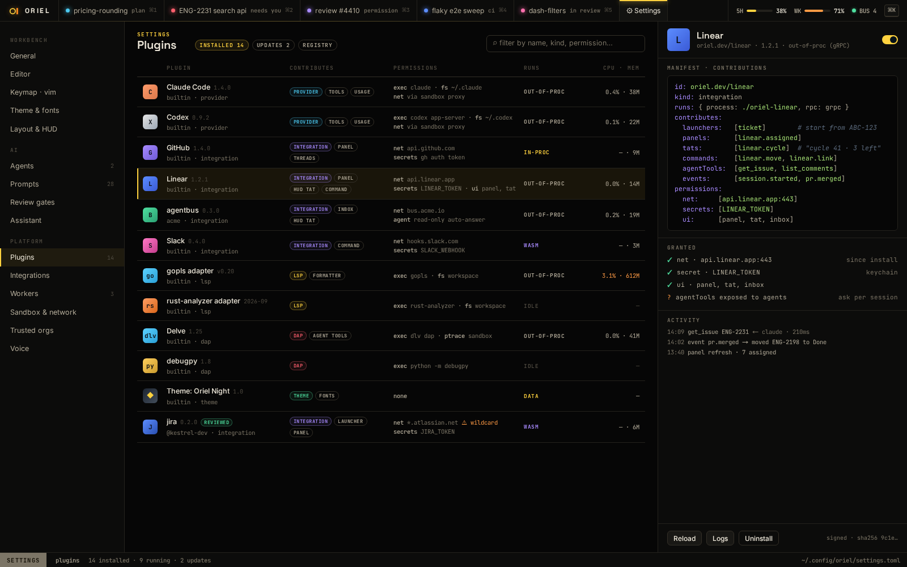
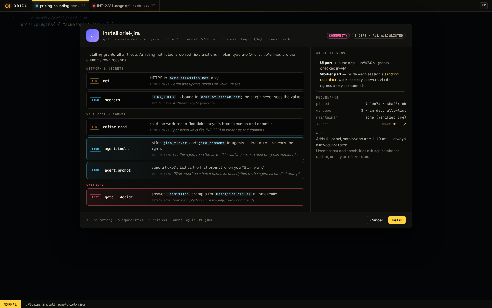

# PL-20 · [plugins] in settings.toml, install from the file, oriel-lock.toml consent

**Phase** 8 · plugin registry · **After** [PL-19](PL-19-package-format-lua-entry-point-assets-plugin-pack.md), [SH-12](SH-12-settings-page-settings-sections-search-typed-co.md), [SH-9](SH-9-inbox-and-interrupt-cards-agentbus-network-gatew.md) · **Unblocks** [PL-21](PL-21-registry-client-badges-and-the-plugins-page.md)

## Design

- `_design/catalog.md` (Data in TOML, logic in Lua; the lockfile)
- `_design/settings.md` (Plugins, live reload, the TOML writer)
- `_design/security.md` (all or nothing)
- `_design/features.md` (this row)

## Mockups

## What

- The `catalog` module. Resolves `[plugins]` entries from `git` and `path` sources here. Registry sources come with PL-21.
- Watching `settings.toml`: install what's missing, uninstall what's removed, respect `enabled = false` and `lazy` overrides.
- `oriel-lock.toml`: commit, hashes, badge and accepted capabilities. Consent is skipped only when the lock covers them.
- Unconsented plugins stay inactive behind an inbox card that opens the consent screen (PL-3).
- `[plugin.<name>]` options through `OptionSpec`, shown on the settings page in the plugin's section.
- Plugins from `.oriel/settings.toml` are installed only once the project is trusted.

## Done when

- Adding a `[plugins]` line installs the plugin. Removing it uninstalls it and drops its lock entry.
- With a fresh data dir and a lockfile that covers the plugin, it activates with no prompt.
  When the plugin asks for more than the lockfile covers, it stays inactive and a card appears.
- A plugin option set in the GUI changes exactly one line under `[plugin.<name>]`.
- A git source installs with the unverified badge and its warning.

## Rules

- Start only when everything in **After** is `done`.
- No special cases: build on the general plugin APIs, and extend them generally if they're missing something (`_design/plugins.md`).
- Test-first, with verified spec references (`_design/testing.md`).
- No new dependency without approval (`_design/deps.md`).
- Update the design doc in the same PR if behaviour differs from it.
