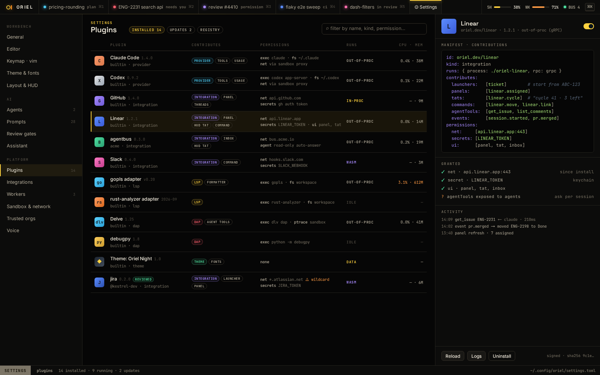
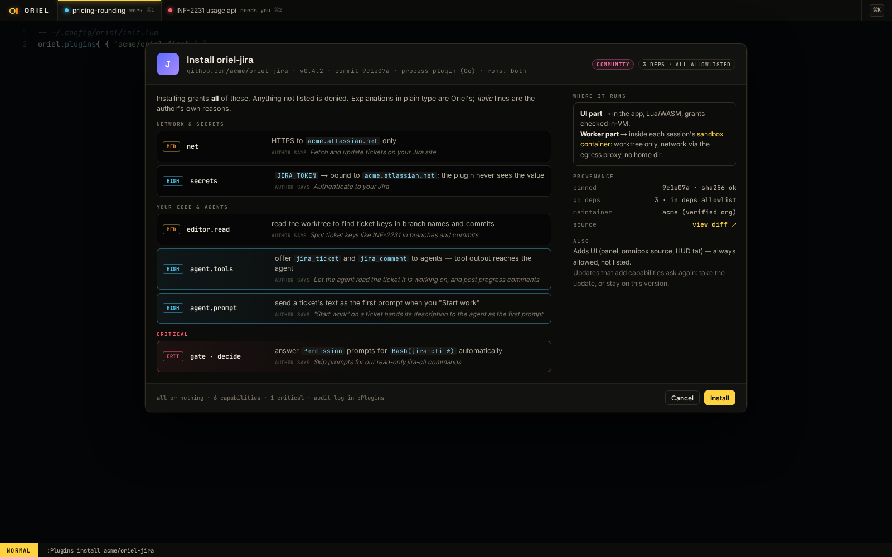

# PL-21 · Registry client, badges, trusted tags, yank and revoke, the Plugins page

**Phase** 8 · plugin registry · **After** [PL-20](PL-20-plugins-in-settings-toml-and-lockfile-consent.md), [PL-6](PL-6-self-update-for-the-app-and-workers-self-signed-.md) · **Unblocks** [PL-17](PL-17-oriel-plugin-publish.md)

## Design

- `_design/catalog.md` (The registry repo, The index, More than one registry, Badges, Updates)
- `_design/distribution.md` (ed25519 verification)
- `_design/ui.md` (16 · Plugins)
- `_design/features.md` (this row)

## Mockups

## What

- Fetch, verify and cache `index.json` from each `[registry] sources`, with the default key embedded in the binary.
- Resolve semver ranges against reviewed versions, or against tags for trusted plugins, honouring `trusted_hold`.
- Yanked versions aren't offered. Revoked ones are disabled, with a card.
- Updates follow `[registry] updates`. Added capabilities go back to the consent screen.
- The page is renamed **Plugins**, with a REGISTRY tab to browse and install, and badges in the list and on the install screen.
- Update the mockup sources for 16 and 29: "Plugins", `settings.toml`, and the new badges. Re-render them.

## Done when

- Against a fixture registry: an index with a bad signature is refused; a revoked version is disabled with a card;
  a trusted tag isn't offered until `trusted_hold` has passed; an id in two registries resolves to the first.
- Installing from the Registry tab writes one line to `[plugins]`, then follows PL-20's path.
- Mockups 16 and 29 are re-rendered with the new wording.

## Rules

- Start only when everything in **After** is `done`.
- No special cases: build on the general plugin APIs, and extend them generally if they're missing something (`_design/plugins.md`).
- Test-first, with verified spec references (`_design/testing.md`).
- No new dependency without approval (`_design/deps.md`).
- Update the design doc in the same PR if behaviour differs from it.
