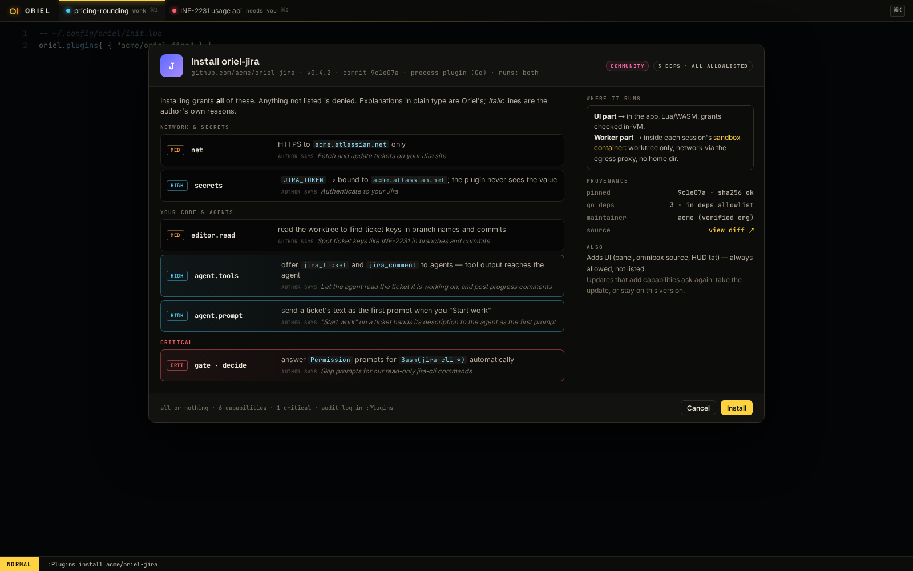

# PL-3 · All-or-nothing install consent, update capability diff

**Phase** 7 · the rest · **After** [PL-2](PL-2-process-plugins-with-an-os-sandbox-wasm-plugins-.md), [ED-11](ED-11-languages-as-plugins-core-grammar-set-and-local-packs.md) · **Unblocks** [PL-19](PL-19-package-format-lua-entry-point-assets-plugin-pack.md), [PL-18](PL-18-rename-ext-to-plugin.md)

## Design

- `_design/security.md`
- `_design/plugins.md`
- `_design/features.md` (this row)

## Mockups

## Grammar packs

- Languages beyond ED-11's core set install as grammar packs through the plugin manager. The packs are built by
  our CI from the pinned grammar manifest and published with checksums; the binary ships the checksum list and
  installs only packs that match it, as `deps.md` requires (no prebuilt `.wasm` from anywhere else). An installed
  pack lands in the languages directory ED-11 loads from.

## Done when

Acceptance tests derived from the design docs above, written first, all passing in CI on macOS and Linux.

## From ED-11

- A grammar pack installs into `~/.config/oriel/languages/<name>/` (`language.toml`, `grammar.wasm`, `queries/`);
  `builtin:languages` registers what's there at startup. Grammars have no host imports, so they need no capabilities.

## As built

- See security.md and plugins.md, "As built (PL-3)", and editor.md, "Languages as plugins" (grammar packs).
  `ext.Ask`/`ext.Consent`, `ext.Locked`/`ext.Diff` and the `plugins.consent` dialog are the pieces PL-20 and PL-21
  build on; recording consent in `oriel-lock.toml`, provenance facts and fetching packs are theirs.

## Rules

- Start only when everything in **After** is `done`.
- No special cases: build on the general plugin APIs, and extend them generally if they're missing something (`_design/plugins.md`).
- Test-first, with verified spec references (`_design/testing.md`).
- No new dependency without approval (`_design/deps.md`).
- Update the design doc in the same PR if behaviour differs from it.
