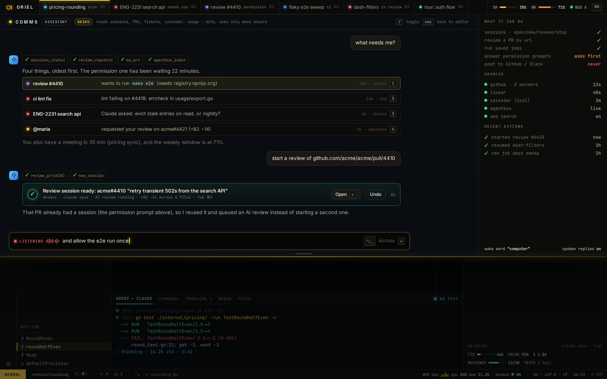

# PL-4 · Comms assistant drawer (utility session, no -p)

**Phase** 7 · the rest · **After** [AI-2](AI-2-claude-provider-interactive-pty-plus-mod-hooks-n.md) · **Unblocks** nothing yet

## Design

- `_design/crit-reference.md`
- `_design/agents.md`
- `_design/ui.md`
- `_design/features.md` (this row)

## Mockups

## Done when

Acceptance tests derived from the design docs above, written first, all passing in CI on macOS and Linux.

## Rules

- Start only when everything in **After** is `done`.
- No special cases: build on the general plugin APIs, and extend them generally if they're missing something (`_design/plugins.md`).
- Test-first, with verified spec references (`_design/testing.md`).
- No new dependency without approval (`_design/deps.md`).
- Update the design doc in the same PR if behaviour differs from it.
