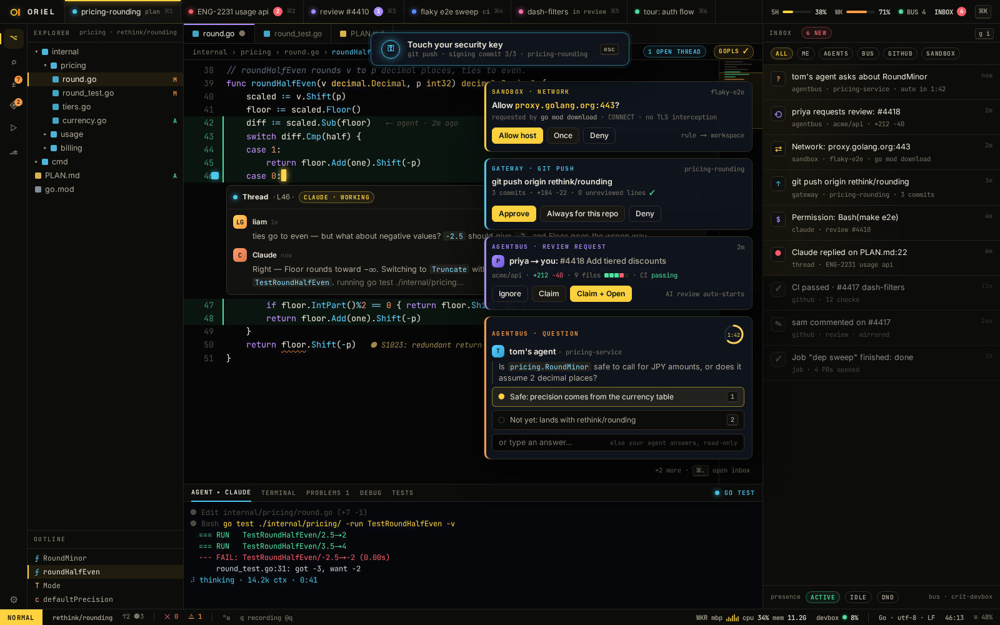

# PL-5 · agentbus: question cards with auto-answer, review requests, presence, log, auto-approve (as a helper process)

**Phase** 7 · the rest · **After** [AI-1](AI-1-worker-wire-sessions-workspaces-with-multi-repo-.md) · **Unblocks** nothing yet

## Design

- `_design/crit-reference.md`
- `_design/plugins.md`
- `_design/security.md`
- `_design/architecture.md`
- `_design/features.md` (this row)

## Mockups

## Done when

`crit-reference.md` → agentbus behaviour reproduced, against a fake bus

## Rules

- Start only when everything in **After** is `done`.
- No special cases: build on the general plugin APIs, and extend them generally if they're missing something (`_design/plugins.md`).
- Test-first, with verified spec references (`_design/testing.md`).
- No new dependency without approval (`_design/deps.md`).
- Update the design doc in the same PR if behaviour differs from it.
