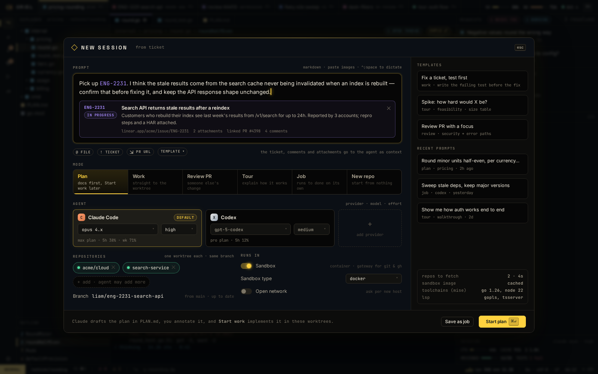
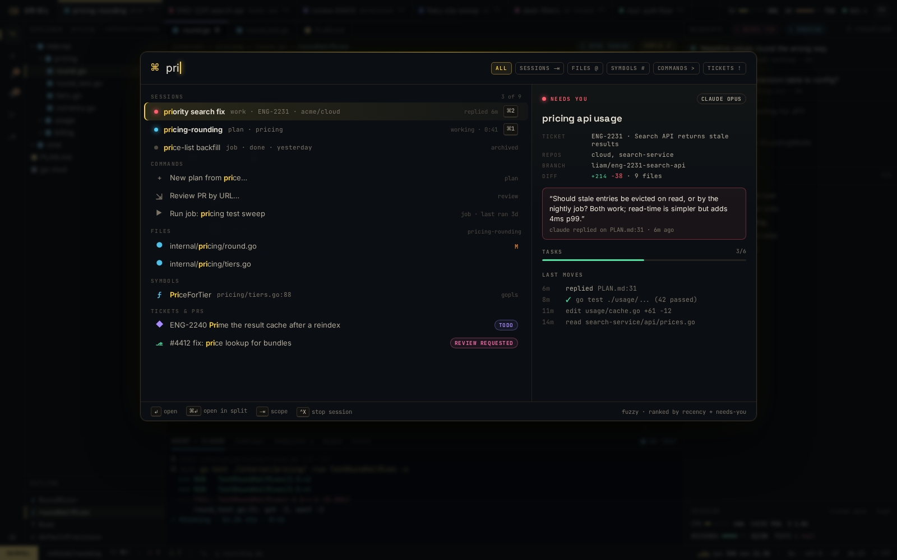

# PL-8 · Linear: assigned tickets, start work from a ticket, state moves, PR links, omnibox source

**Phase** 7 · the rest · **After** [PL-2](PL-2-process-plugins-with-an-os-sandbox-wasm-plugins-.md), [SE-1](SE-1-session-kinds-plan-work-review-tour-job-new-repo.md) · **Unblocks** nothing yet

## Design

- `_design/crit-reference.md`
- `_design/plugins.md`
- `_design/security.md`
- `_design/sessions.md`
- `_design/features.md` (this row)

## Mockups

## Done when

`crit-reference.md` → Linear, against a recorded Linear API

## Rules

- Start only when everything in **After** is `done`.
- No special cases: build on the general plugin APIs, and extend them generally if they're missing something (`_design/plugins.md`).
- Test-first, with verified spec references (`_design/testing.md`).
- No new dependency without approval (`_design/deps.md`).
- Update the design doc in the same PR if behaviour differs from it.
