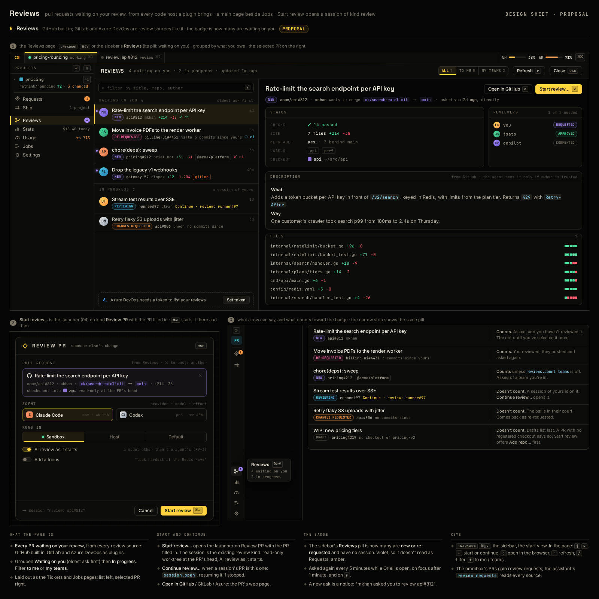

# RV-10 · Review kind made host-agnostic: the source says where to fetch

**Phase** 7 · the rest · **After** RV-9

## Design

- `_design/ui.md` ("46 · Reviews")
- `_design/plugins.md` ("As built (reviews)")
- `_design/scripting.md` ("As built (reviews)")

## Mockups

## Done when

the host checks out `SessionSpec.PRRemote` / `PRRef` with no provider code (a GitLab-style
`merge-requests/N/head` against a fixture origin); a bare GitHub URL still works.

Built: `SessionSpec.PRRemote`/`PRRef`, `sessions.prCheckout`, `host.prRepo`/`addPRProject` (plugins.md "As built
(reviews)").
