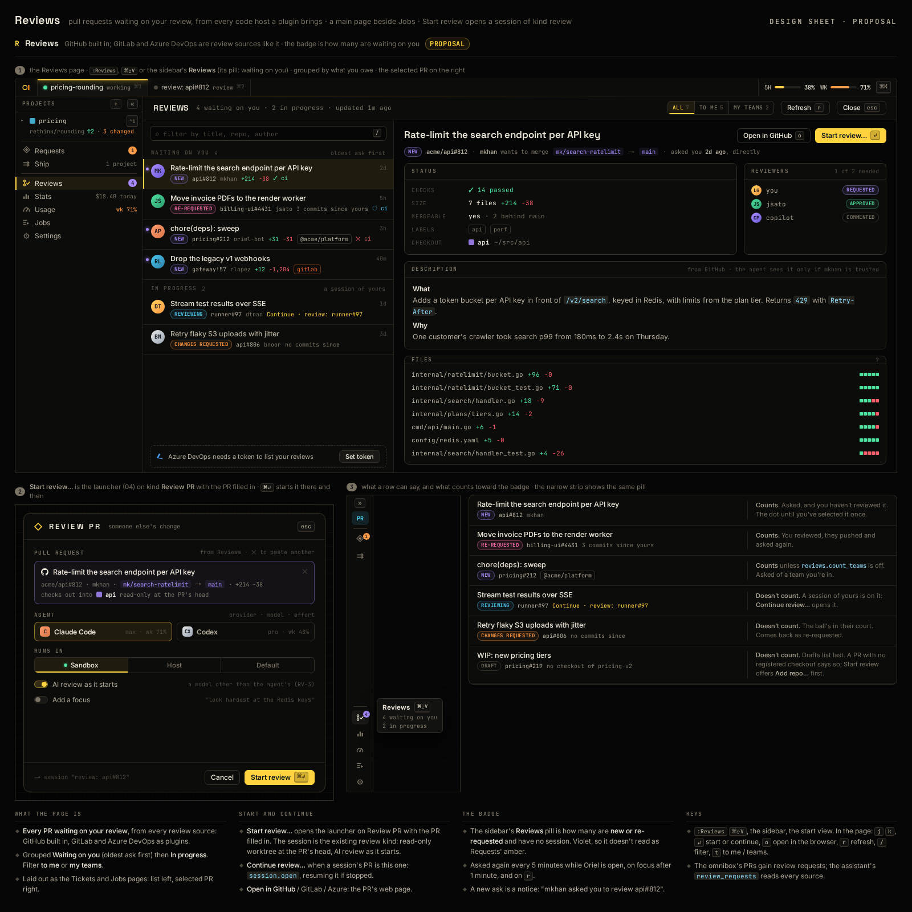

# RV-11 · GitLab code host plugin: review, raise and merge

**Phase** 7 · the rest · **After** RV-13, PL-2

## Design

- `_design/ui.md` ("46 · Reviews")
- `_design/plugins.md` ("As built (code hosts)")
- `_design/scripting.md` ("As built (code hosts)")

## Mockups

## Done when

against a recorded GitLab API: merge requests asking you (and your groups), their state from your approval and
notes, commits since, pipeline status; checkout `merge-requests/N/head`; its token a secret, the source hidden until
it's set. Shaped as Linear: Lua front on `oriel.code.host`, a process for the API.
Ship raises and edits an MR ("Raise MR…", "!57"), reads its pipeline, and Merge… warns of unresolved discussions, then merges at the head shown with the project's merge method and squash option.
