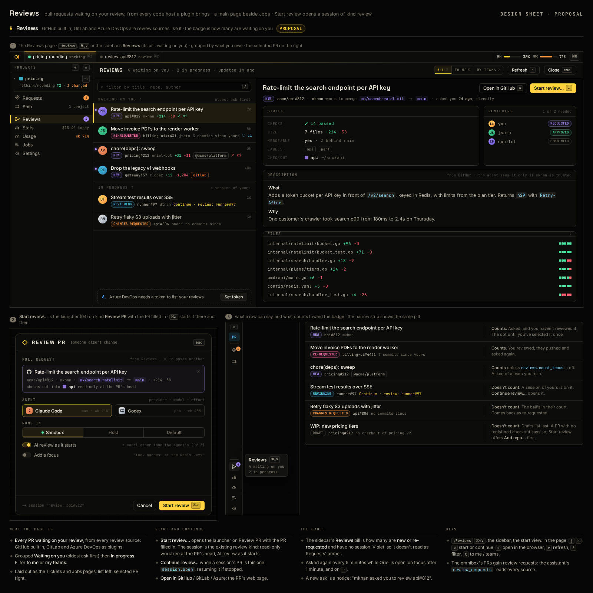

# RV-12 · Azure DevOps code host plugin: review, raise and merge

**Phase** 7 · the rest · **After** RV-13, PL-2

## Design

- `_design/ui.md` ("46 · Reviews")
- `_design/plugins.md` ("As built (code hosts)")
- `_design/scripting.md` ("As built (code hosts)")

## Mockups

## Done when

against a recorded Azure DevOps API: PRs asking you (and your teams), your vote as the state, checkout of the
source branch (`refs/heads/<branch>`: Azure has no PR head ref); its token a secret.
Ship raises and edits a PR, reads its statuses, and Merge… warns of active threads and rejecting votes, then completes it at the head shown.
