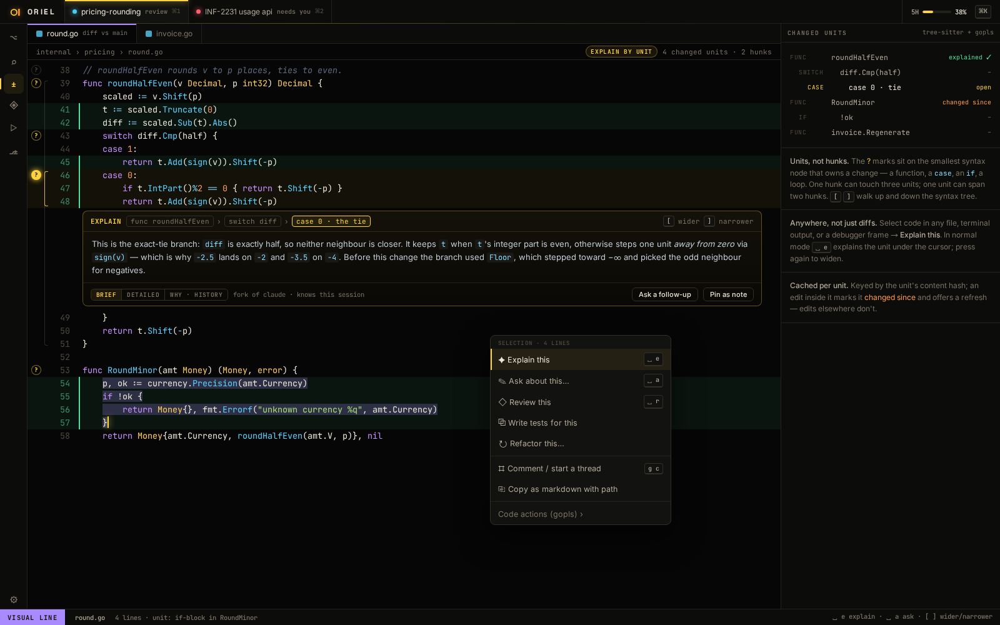

# RV-5 · Explain by code unit, [/] widen and narrow, Explain this on a selection

**Phase** 6 · review · **After** [ED-6](ED-6-tree-sitter-highlighting-folds-outline-code-unit.md), [AI-2](AI-2-claude-provider-interactive-pty-plus-mod-hooks-n.md) · **Unblocks** [RV-6](RV-6-explain-this-change-walkthrough.md), [RV-8](RV-8-tours-reader-7-kinds-export.md), [TR-6](TR-6-ask-to-explain-next-to-every-ask-to-fix-tests-di.md)

## Design

- `_design/ui.md`
- `_design/editor.md`
- `_design/features.md` (this row)

## Mockups

## Done when

units are correct for fixtures in 4 languages; cache invalidated only by edits inside the unit

## Rules

- Start only when everything in **After** is `done`.
- No special cases: build on the general plugin APIs, and extend them generally if they're missing something (`_design/plugins.md`).
- Test-first, with verified spec references (`_design/testing.md`).
- No new dependency without approval (`_design/deps.md`).
- Update the design doc in the same PR if behaviour differs from it.
