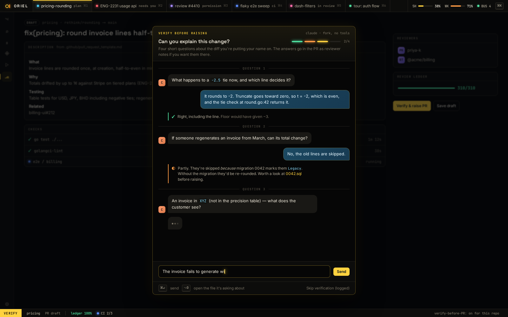

# RV-7 · Verify & raise quiz

**Phase** 6 · review · **After** [AI-5](AI-5-requests-inline-threads-plus-the-main-requests-v.md) · **Unblocks** nothing yet

## Design

- `_design/crit-reference.md`
- `_design/agents.md`
- `_design/ui.md`
- `_design/features.md` (this row)

## Mockups

## Done when

Acceptance tests derived from the design docs above, written first, all passing in CI on macOS and Linux.

## Rules

- Start only when everything in **After** is `done`.
- No special cases: build on the general plugin APIs, and extend them generally if they're missing something (`_design/plugins.md`).
- Test-first, with verified spec references (`_design/testing.md`).
- No new dependency without approval (`_design/deps.md`).
- Update the design doc in the same PR if behaviour differs from it.

## Changed after review

- Verify is optional, a thing of its own: a raise never waits for it, so there's no skip. It starts from **Verify…**
  on its "before this ships" row (ui.md 13).
