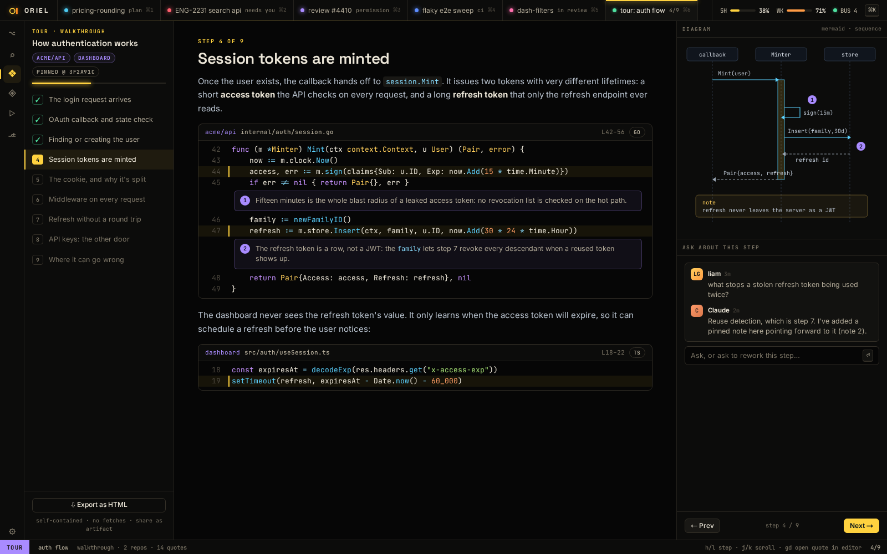

# RV-8 · Tours: reader, 7 kinds, export

**Phase** 7 · the rest · **After** [RV-5](RV-5-explain-by-code-unit-widen-and-narrow-explain-th.md) · **Unblocks** nothing yet

## Design

- `_design/crit-reference.md`
- `_design/ui.md`
- `_design/features.md` (this row)

## Mockups

## Done when

crit's tour features ported

## Rules

- Start only when everything in **After** is `done`.
- No special cases: build on the general plugin APIs, and extend them generally if they're missing something (`_design/plugins.md`).
- Test-first, with verified spec references (`_design/testing.md`).
- No new dependency without approval (`_design/deps.md`).
- Update the design doc in the same PR if behaviour differs from it.
