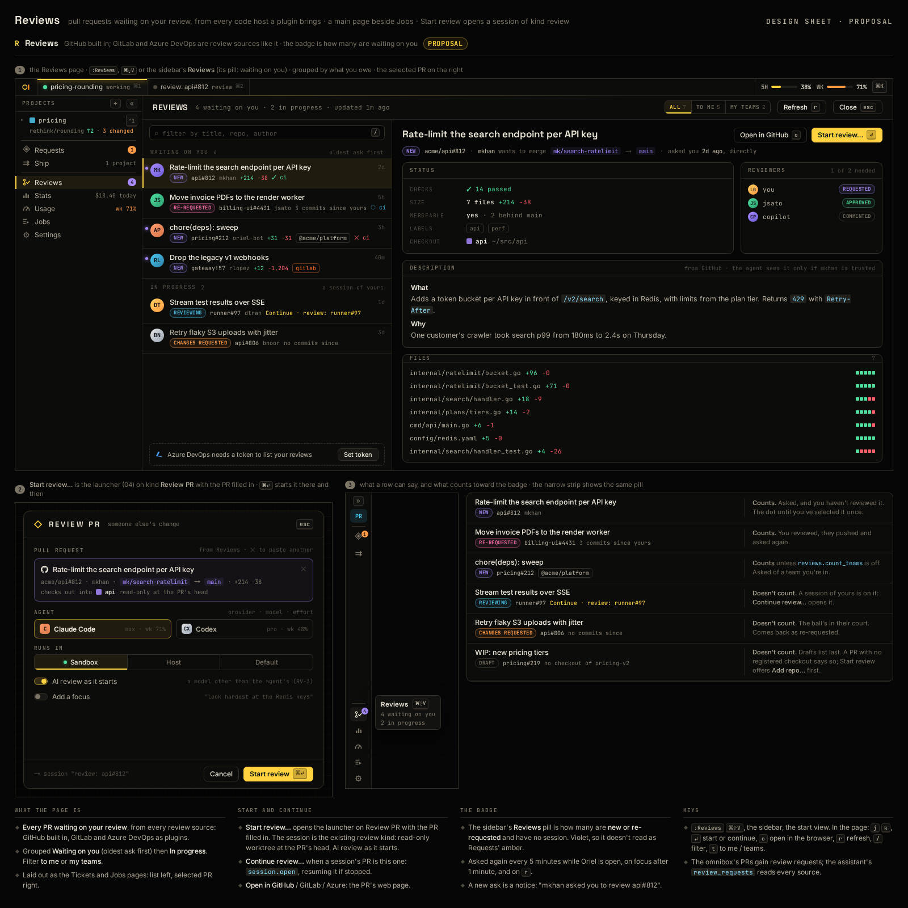

# RV-9 · Reviews page: PRs waiting on your review, GitHub built in

**Phase** 7 · the rest · **After** RV-4, PL-8

## Design

- `_design/ui.md` ("46 · Reviews")
- `_design/plugins.md` ("As built (reviews)")
- `_design/scripting.md` ("As built (reviews)")

## Mockups

## Done when

against the fake GitHub: asks of you and your teams, re-requested with commits since, and your changes-requested
ones list in their groups and order; the sidebar's pill counts new and re-requested (teams per
`reviews.count_teams`); Start review opens the launcher on Review PR with the PR filled in, Continue review opens the
session that has it; a new ask is a notice; a Lua `oriel.review.source` lists beside GitHub.

Built: `registry.ReviewSource`, `gh.API.ReviewQueue`, `app/reviews.go`, `app/reviewspage.go`,
`app/reviews_github.go`, `RailEntry.BadgeTone` (ui.md "46 · Reviews", plugins.md "As built (reviews)").
