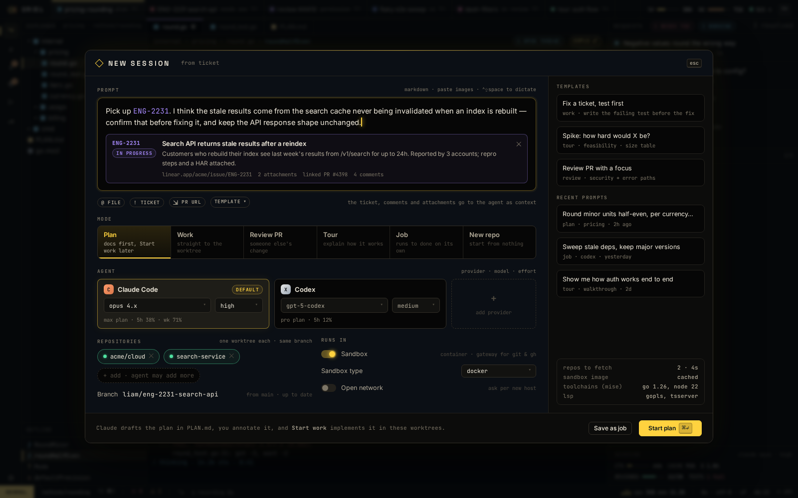

# SE-1 · Session kinds plan, work, review, tour, job, new repo, direct and scratch (sessions.md)

**Phase** 5 · AI · **After** [AI-1](AI-1-worker-wire-sessions-workspaces-with-multi-repo-.md) · **Unblocks** [PL-8](PL-8-linear-assigned-tickets-start-work-from-a-ticket.md), [SE-2](SE-2-session-lifecycle-worktrees-from-a-fetched-base-.md), [SE-3](SE-3-files-outside-the-session-open-read-only-app-ope.md)

## Design

- `_design/sessions.md`
- `_design/architecture.md`
- `_design/features.md` (this row)

## Mockups

## Done when

each kind starts from the launcher and the CLI; direct never creates a worktree; new repo inits and registers

## Rules

- Start only when everything in **After** is `done`.
- No special cases: build on the general plugin APIs, and extend them generally if they're missing something (`_design/plugins.md`).
- Test-first, with verified spec references (`_design/testing.md`).
- No new dependency without approval (`_design/deps.md`).
- Update the design doc in the same PR if behaviour differs from it.

## From SH-15

- SH-15's Open Directory is the pre-session **direct** kind; its recent directories carry over as direct sessions.
- `oriel <dir>` opens the directory directly today. With sessions, ask first: start a session on it, or open it directly.
- Register `session.new` and `session.resume`; the start view's greyed entries light up on their own.
