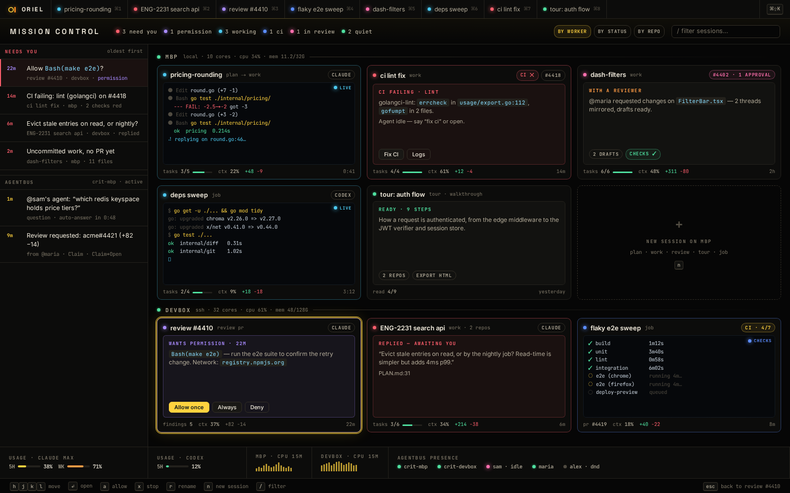

# SE-2 · Session lifecycle: worktrees from a fetched base, Start next PR, archive, resume after restart

**Phase** 5 · AI · **After** [SE-1](SE-1-session-kinds-plan-work-review-tour-job-new-repo.md) · **Unblocks** nothing yet

## Design

- `_design/sessions.md`
- `_design/architecture.md`
- `_design/features.md` (this row)

## Mockups

## Done when

archived sessions keep threads and transcripts searchable; restart restores the layout

## Rules

- Start only when everything in **After** is `done`.
- No special cases: build on the general plugin APIs, and extend them generally if they're missing something (`_design/plugins.md`).
- Test-first, with verified spec references (`_design/testing.md`).
- No new dependency without approval (`_design/deps.md`).
- Update the design doc in the same PR if behaviour differs from it.
