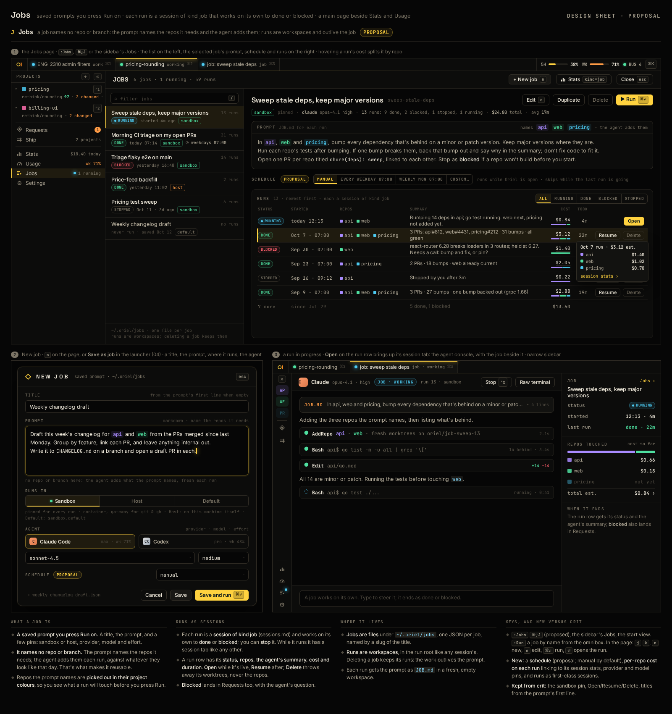

# SE-4 · Jobs: saved prompts, runs as sessions, a Jobs page, and schedules

**Phase** 5 · AI (follow-up) · **After** [SE-1](SE-1-session-kinds-plan-work-review-tour-job-new-repo.md), [AI-12](AI-12-stats-and-usage-pages-grouped-by-repo.md) · **Unblocks** nothing yet

Added after P5 from review: crit's jobs with a page of their own. Mockup 44 was signed off.

## Design

- `_design/mockups/44-jobs.png` (source `src/44-jobs.html`): the three panels and the notes are the spec.
- `_design/sessions.md` (the job kind), `_design/crit-reference.md` (crit's `internal/job`, `web/static/dash/jobs.js`)

## Mockups

## What it is

- **A job** is a saved prompt with a title and pins (sandbox or host, worker, provider, model, effort, schedule); it
  names no repo or branch: the prompt names the repos and the agent adds them. One JSON file per job under
  `~/.oriel/jobs` on the worker.
- **A run** is a session of kind `job` in a fresh workspace, given the prompt as `JOB.md`; it works on its own to
  done or blocked, can be stopped, and its row keeps status, repos, the agent's summary, cost split by repo (AI-12) and
  duration. Open while live, Resume after, Delete throws the workspace away. A blocked run also lands in Requests with
  the agent's question.
- **The Jobs page** (`:Jobs`, `⌘⇧J`, the sidebar's Jobs): the job list, the selected job's prompt (repos it names in
  their colours), Edit, Duplicate, Delete, Run (`⌘↵`), its schedule, and its runs with filters; New job (`n`) and
  "Save as job" in the launcher; Stats kind=job.
- **Schedules:** manual by default, or every weekday / weekly at a time, or custom; a scheduled run is skipped while
  the last one is still going; runs on the worker when it's awake.
- Run status colours are theme tokens: running (working), done, blocked, stopped.

## Done when

- A job saved from the page or the launcher runs as a job session against a fake provider; its row shows status,
  repos, summary, cost by repo and duration; Open, Resume and Delete work; a blocked run shows in Requests.
- A schedule fires a run at its time on a fake clock and skips while one is running.
- The page matches 44's panels from fixture jobs and runs; `:Jobs`, `⌘⇧J` and the sidebar entry open it.

## Rules

- Start only when everything in **After** is `done`.
- No special cases: build on the general plugin APIs, and extend them generally if they're missing something (`_design/plugins.md`).
- Test-first, with verified spec references (`_design/testing.md`).
- No new dependency without approval (`_design/deps.md`).
- Update the design doc in the same PR if behaviour differs from it.
