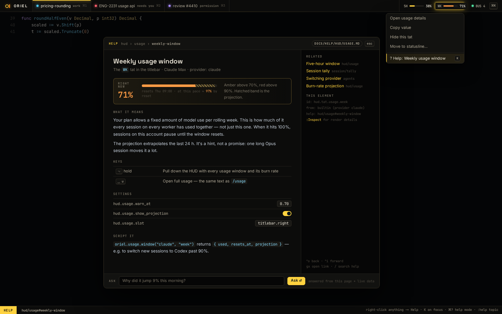

# SH-10 · Help everywhere (right-click → Help, K, ⌘?, :help)

**Phase** 3 · shell · **After** [FW-6](FW-6-widgets-buttons-chips-inputs-virtual-lists-trees.md) · **Unblocks** nothing yet

## Design

- `_design/help.md`
- `_design/ui.md`
- `_design/features.md` (this row)

## Mockups

## Done when

CI lint: every interactive element resolves to a help page and anchor

## From SH-5

- Add help as a picker source (`␣h`): `Registry.Picker` with `PickerOnly` and a preview of the page.

## Rules

- Start only when everything in **After** is `done`.
- No special cases: build on the general plugin APIs, and extend them generally if they're missing something (`_design/plugins.md`).
- Test-first, with verified spec references (`_design/testing.md`).
- No new dependency without approval (`_design/deps.md`).
- Update the design doc in the same PR if behaviour differs from it.
