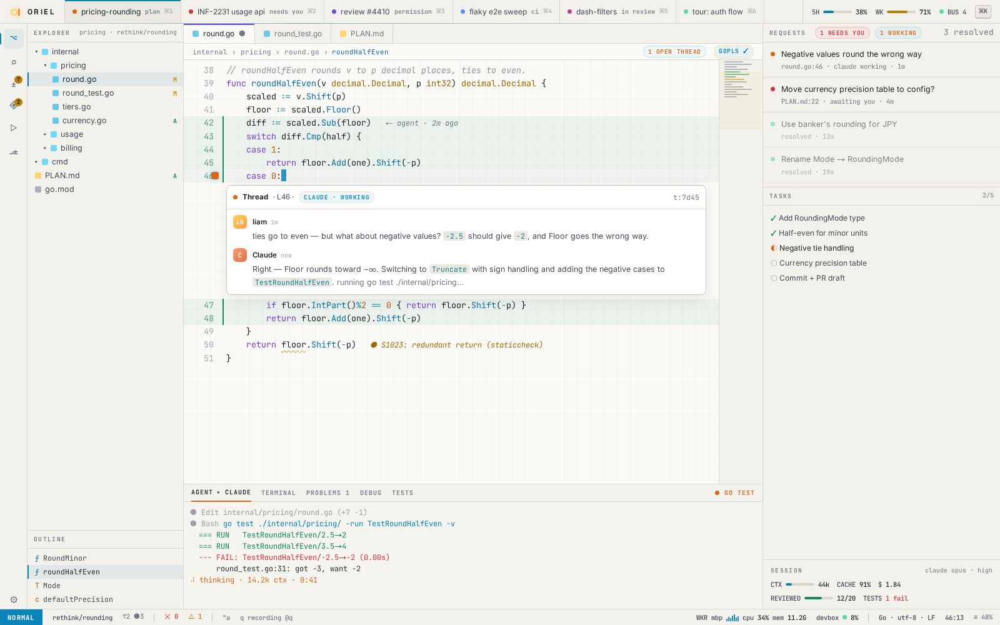
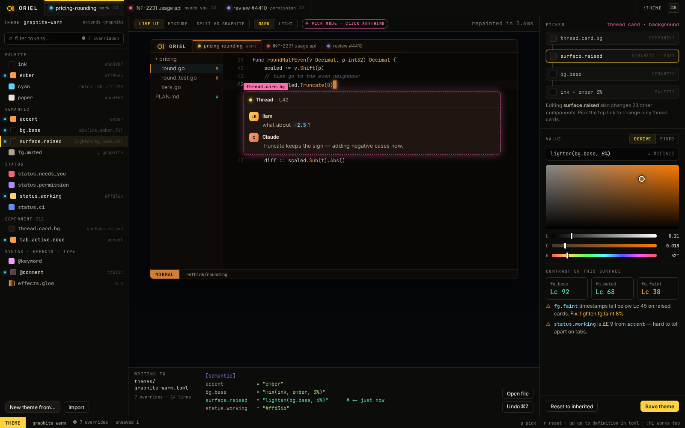

# SH-11 · Light, dark and theme editor (:Theme, pick mode)

**Phase** 3 · shell · **After** [FW-7](FW-7-theme-tokens-layered-resolution-live-reload-the-.md) · **Unblocks** nothing yet

## Design

- `_design/theming.md`
- `_design/ui.md`
- `_design/features.md` (this row)

## Mockups

## Done when

token resolution tests; the fixture renders in all built-in themes; pick-to-override writes the smallest TOML diff

## Rules

- Start only when everything in **After** is `done`.
- No special cases: build on the general plugin APIs, and extend them generally if they're missing something (`_design/plugins.md`).
- Test-first, with verified spec references (`_design/testing.md`).
- No new dependency without approval (`_design/deps.md`).
- Update the design doc in the same PR if behaviour differs from it.
