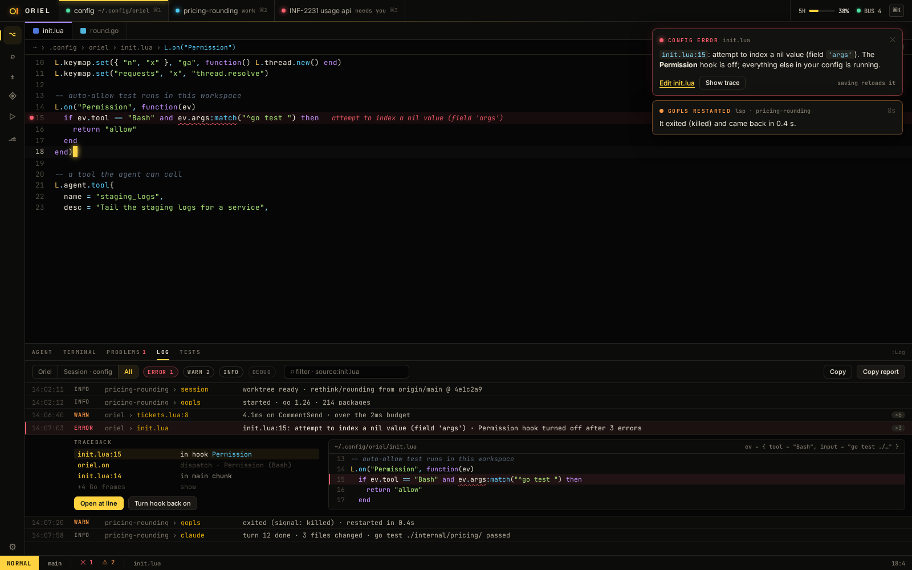
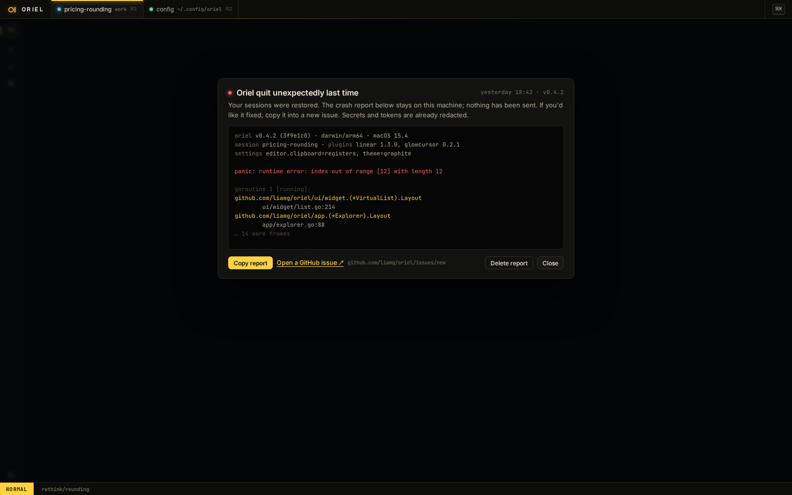

# SH-13 · Errors, notifications and the log panel

**Phase** 3 · shell · **After** [FW-2](FW-2-event-store-typed-events-materialised-core-state.md), [FW-6](FW-6-widgets-buttons-chips-inputs-virtual-lists-trees.md), [FW-9](FW-9-layout-tree-and-tab-groups-drag-any-pane-to-any-.md), [ED-6](ED-6-tree-sitter-highlighting-folds-outline-code-unit.md) · **Unblocks** [ED-12](ED-12-editor-pane-files-and-the-first-usable-editor.md), [PL-12](PL-12-lua-errors-tracebacks-diagnostics-and-turning-off-failing-hooks.md)

## Design

- `_design/errors.md` (all of it)
- `_design/sessions.md` (the session log lives with the session)
- `_design/architecture.md` (events), `_design/plugins.md` (the notify API)
- `_design/ui.md`, `_design/rendering.md` (toasts, panels), `_design/security.md` (redaction)
- `_design/testing.md`
- `_design/features.md` (this row)

## Mockups

Also the "reloaded init.lua" toast in `19-config.png` and the status line's ✕/⚠ counts in `12-inbox.png`.

## What

- The `Notified` core event and the notification history in `core.State`, with IDs, severity, source, detail,
  location, actions, and repeats collapsed with a count. `edit.Notice` maps onto it. A registry API to send and read.
- Two logs: the Oriel log and one per session, kept on the session's worker and archived with it. Each notice goes
  to one by its source; errors from an unfocused session mark its tab instead of toasting.
- Where each notice shows, per the table in `errors.md`: toasts for now, ✕/⚠ counts, modal only when Oriel can't go on.
- The log panel (`:messages`, `:Log`): Oriel, Session and All scopes, history plus log records, filters, search, stack traces with each frame
  linked, the failing source highlighted, "Copy" and "Copy report".
- `log/slog` everywhere, an in-memory ring and a rotating file per platform, worker records streamed to the app,
  LSP/DAP/process-plugin stderr captured, levels by flag, env and `:Log level`, secrets redacted.
- `recover` around every contribution call: a panic is an error notice with its Go stack and turns that
  contribution off. A crash report on Oriel's own panic, offered on the next launch with Copy report and a link to a new GitHub
  issue; nothing is sent.
- `:Events` and `oriel --debug`.

## Done when

- Display-list snapshots match `37-errors.png` and `38-crash.png`: an info toast, an error toast with actions, the
  ✕/⚠ counts, the log panel in each scope with an expanded trace and highlighted source, and the crash modal.
- A session's log survives a worker restart, and an error in an unfocused session marks its tab without a toast.
- A notice repeated 100 times is one history row with ×100, and one toast.
- A panicking hook, view and command each produce an error notice with the Go stack, are turned off, and the app
  keeps handling keys.
- A forced panic outside a contribution writes a crash report, and the next launch offers it.
- Records with a secret from the secrets store or a token in a URL are redacted in the panel, the file and the report.
- Replaying an event log reproduces the notification history.

## Rules

- Start only when everything in **After** is `done`.
- No special cases: build on the general plugin APIs, and extend them generally if they're missing something (`_design/plugins.md`).
- Test-first, with verified spec references (`_design/testing.md`).
- No new dependency without approval (`_design/deps.md`).
- Update the design doc in the same PR if behaviour differs from it.
