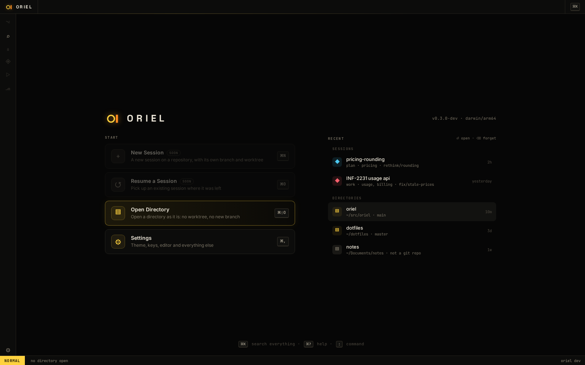
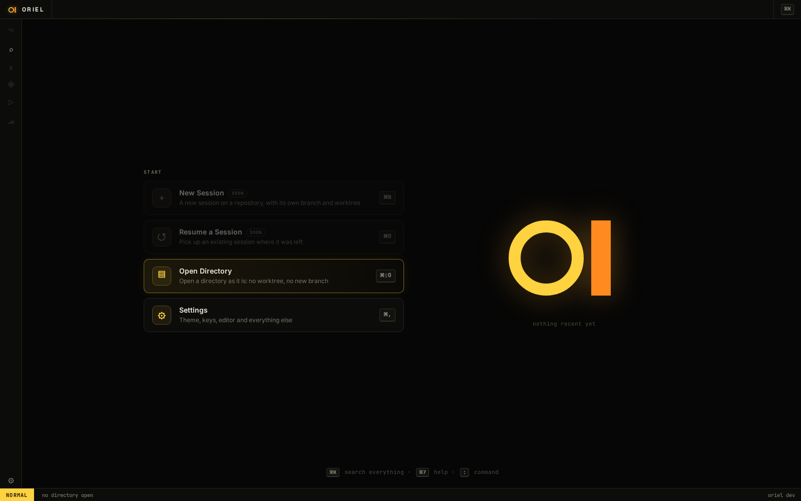

# SH-15 · Start view: what the window shows with nothing open

**Phase** 3 · shell · **After** [SH-14](SH-14-closing-views-and-real-keys-and-commands-lists.md), [ED-12](ED-12-editor-pane-files-and-the-first-usable-editor.md), [SH-4](SH-4-k-omnibox-sessions-commands-files-symbols-ticket.md), [SH-12](SH-12-settings-page-settings-sections-search-typed-co.md) · **Unblocks** nothing yet; [SE-3](SE-3-files-outside-the-session-open-read-only-app-ope.md) replaces it with mission control

## Design

- `_design/ui.md` (01e · Start view)
- `_design/sessions.md` (what replaces it once sessions exist)
- `_design/plugins.md` (the view and its entries are registry contributions)
- `_design/features.md` (this row)

## Mockups

## What

- A registry `View` shown when **nothing is open**: no directory and no session. Once a directory or session is open,
  an empty main area shows its project overview instead ([FG-7](FG-7-project-overview-stats-for-each-repo-with-nothing-open.md)).
- **Minimal, two columns.**
  - **Left: actions**, each a command with its title, a one-line description and its key:
    - **New Session**: a new session on a repository, with a new branch and worktree (`session.new`, AI-4), `⌘N`.
    - **Resume a Session**: pick an existing session (`session.resume`, SE-1), `⌘O`.
    - **Open Directory**: open a directory as it is, with no worktree or branch (`directory.open`), `⌘⇧O`.
    - **Settings** (`settings.open`, `⌘,`).
  - **Right: recents**: recent sessions and recent directories opened with Open Directory, newest first.
    With neither, the big `o▌` logo instead.
- **Keys are ordinary keymaps**, so users rebind, unbind or override them like any other; each row shows whatever
  key is bound now (none if unbound).
- **Entries are a contribution point** (command id, title, description), so plugins add their own. An entry whose
  command isn't registered yet is greyed out; New Session and Resume a Session stay grey until AI-4 and SE-1 register them.
- **The same actions are in the omnibox**, as the commands they run.
- **Open Directory** asks for a directory in a picker: a new `directories` picker source, with typed paths and tab
  completion, fuzzy matches under `~` (git repos and recent directories first), and a **Browse…** row that opens the
  OS's folder chooser: `osascript`'s `choose folder` on macOS, `zenity` or `kdialog` on Linux (tools, not
  dependencies; `gioui.org/x/explorer` only chooses files). Either way it reopens the window on the directory (every extension starts again on it, so the editor's root, files picker,
  grep and project settings all follow) and records it in the recent directories, kept in Oriel's state directory. Once sessions exist this is the
  **direct** kind (`sessions.md`).
- **Plain `oriel` always opens on the start view**, wherever it's launched from; `oriel .` opens the current directory.
- **`oriel <dir>`** is Open Directory on `<dir>` (today `main.go` reads it as a subcommand). Later, once sessions exist,
  it should ask: start a session on it, or open it directly.

## Done when

launch shows the start view (snapshot, both variants, with and without recents); with nothing open, closing the last view brings it back;
every registered entry runs its command and shows its key, unregistered ones are grey; a plugin-added entry appears;
`oriel <dir>` and Open Directory both set the window's directory and add it to the recents

## Rules

- Start only when everything in **After** is `done`.
- No special cases: build on the general plugin APIs, and extend them generally if they're missing something (`_design/plugins.md`).
- Test-first, with verified spec references (`_design/testing.md`).
- No new dependency without approval (`_design/deps.md`).
- Update the design doc in the same PR if behaviour differs from it.
