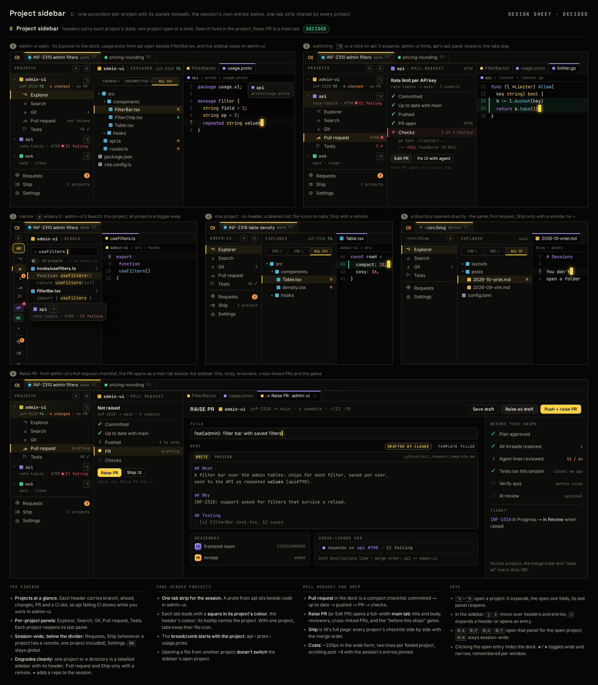

# SH-17 · Project sidebar: per-project panels, the session's entries, one tab strip across projects

**Phase** 5 · AI (follow-up) · **After** [SH-16](SH-16-the-rail-main-views-down-the-left-edge.md), [FG-1](FG-1-explorer-scopes-changed-uncommitted-all-with-mar.md), [FG-3](FG-3-project-search-and-replace-preview.md), [TR-3](TR-3-tests-panel-tree-filters-flaky-detection-run-his.md), [AI-1](AI-1-worker-wire-sessions-workspaces-with-multi-repo-.md), [SE-1](SE-1-session-kinds-plan-work-review-tour-job-new-repo.md) · **Unblocks** nothing yet ([FG-6](FG-6-ship-page-uncommitted-behind-unpushed-pr-checks-.md) fills its Pull request and Ship slots)

Added after P5: multi-project sessions (AI-1, SE-1) need a way to work in one project at a time. Design proposal D was
picked.

## Design

- `_design/ui.md` (01h · Project context: the project sidebar; 01f · The rail; 01c; 18 · Ship)
- `_design/sessions.md` (projects in a session, direct sessions; In the editor)
- `_design/plugins.md` (rail entries, views, contribution points)

## Mockups

42 is the whole sidebar: wide and narrow, one project, a directory, the shared tab strip, and the Raise PR main tab.
18 is Ship, the session-wide page.

## What

- The rail becomes the **project sidebar**: one accordion per project, with a header showing branch, ahead/behind,
  changed files, PR and a CI dot. The open project's entries are Explorer, Search, Git, Pull request and Tests.
  Below a divider are the session's entries: Requests (count), Ship (when any project has a remote), Settings.
- Clicking a header or pressing `⌃1–9` opens that project and reopens its last panel. In the sidebar, `j`/`k`/`⏎`
  move and open. `⌘⇧E/F/G/T` open the open project's panel, `⌘⇧R` stays session-wide, and clicking the open entry
  hides the dock.
- Search is per project, with an **All projects** toggle. `⌘K` stays global.
- `«`/`»` switch between wide and narrow (the icon strip), remembered per window. One project or a directory has no
  header, and Pull request appears only with a remote. Ship appears whenever any project has a remote, one project
  included (18 with one column); a plain directory without a remote has none.
- A `+` in the PROJECTS header (narrow: under the initials) adds a project: a picker of the worker's registered repos
  not in the session, and a typed checkout path. Choosing one runs `session.add-repo`, and the new project opens.
  There's no `+` for a direct session, or while no worker is connected.
- One tab strip for the session. Tabs lead with their project's colour square and their tooltip names the project.
  The breadcrumb starts with the project. Opening another project's file doesn't change the open project.
- Pull request and Ship are greyed until FG-6 makes them available, as SH-16 did. FG-6 builds the dock's compact
  checklist, the **Raise PR / Edit PR main tab** and Ship (18) on the slots this ticket adds.

## Notes

- **Build it on the public plugin APIs**, as a plugin would (`AGENTS.md`). Add the general pieces first, with their
  Lua/RPC bindings, and document them in `plugins.md` / `scripting.md`:
  - **Rail entries become per-project panel contributions.** `RailEntry` / `oriel.rail.add` gets a scope, `project`
    or `session`. A project entry is listed under every project and runs its command with that project. The
    built-ins register Explorer, Search, Git, Pull request and Tests as project entries, and Requests, Ship and
    Settings as session entries. A plugin entry gets the same placement, badge and availability.
  - **Views get a project scope.** A view instance carries the project it was opened for (`core.RepoID`, none for
    session views). `view.open` takes it, the dock header and tab tooltip show it, and `registry.Persisted` keeps it
    across restarts.
  - **The multi-project Explorer, Git, Tests and Search each read their project from the view's scope**, not from a
    global "current project". No special case for the sidebar: Search's All projects toggle is its own option.
  - Project colour, the open project and each project's last panel live in `core` state with events. Wide/narrow is a
    per-window option. Tab squares and breadcrumbs read the buffer's project through the existing tab marker and
    breadcrumb paths, extended generally if needed.
- Update `ui.md` 01c and 01f and `sessions.md` → In the editor where they still describe the rail or one root per
  project. Add a `features.md` row.

## Done when

- A snapshot of the sidebar matches 42's panels 1–5: three projects (wide), narrow, one project, and a directory.
  Each header shows its project's branch, ahead count, changes, PR and CI state from fixture repos.
- Clicking api's header or pressing `⌃2` opens api and folds admin-ui. Switching back to admin-ui reopens the panel
  it had last, and the dock header reads "admin-ui · Explorer". `j`/`k`/`⏎` in the sidebar do the same.
- `⌘⇧F` opens the open project's Search, which finds matches only in that project. The All projects toggle adds the
  other projects' matches, grouped by project.
- A plugin registers a project-scoped entry from Lua. It appears under every project, opens its view with that
  project's scope, and can be removed. A session-scoped plugin entry appears below the divider.
- With admin-ui open, opening `api/proto/usage.proto` adds a tab beside `FilterBar.tsx` with api's colour square,
  a tooltip naming api, and the breadcrumb `api › proto › usage.proto`. The sidebar stays on admin-ui.
- Wide/narrow survives a restart for that window. Clicking the open entry hides the dock. A directory session shows no
  Pull request entry without a remote.
- Pull request and Ship are greyed until something registers their views. A one-project session with a remote lists
  Ship; a directory without one doesn't.
- Clicking `+` in the sidebar and picking a repo (or typing its path) adds it to the session: it appears as a project
  and opens.

## Rules

- Start only when everything in **After** is `done`.
- No special cases: build on the general plugin APIs, and extend them generally if they're missing something (`_design/plugins.md`).
- Test-first, with verified spec references (`_design/testing.md`).
- No new dependency without approval (`_design/deps.md`).
- Update the design doc in the same PR if behaviour differs from it.
