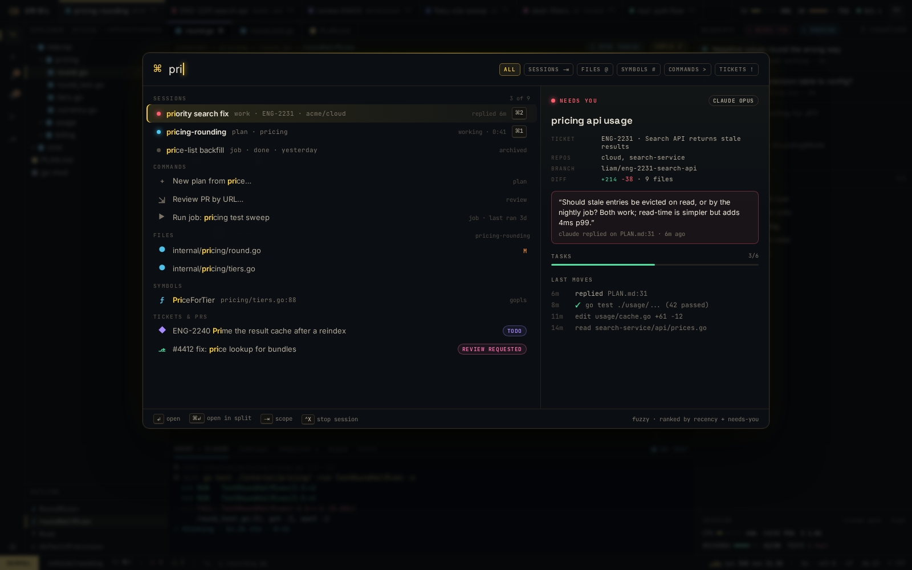

# SH-4 · ⌘K omnibox (sessions, commands, files, symbols, tickets, PRs) with prefixes

**Phase** 3 · shell · **After** [FW-6](FW-6-widgets-buttons-chips-inputs-virtual-lists-trees.md), [FW-3](FW-3-registries-commands-keymaps-modes-chords-panel-l.md) · **Unblocks** [SH-5](SH-5-pickers-files-grep-k-keymaps-with-preview-and-ac.md)

## Design

- `_design/ui.md`
- `_design/shell.md`
- `_design/rendering.md`
- `_design/help.md`
- `_design/theming.md`
- `_design/features.md` (this row)

## Mockups

## Done when

fuzzy ranking golden tests; preview pane renders for each source

## Rules

- Start only when everything in **After** is `done`.
- No special cases: build on the general plugin APIs, and extend them generally if they're missing something (`_design/plugins.md`).
- Test-first, with verified spec references (`_design/testing.md`).
- No new dependency without approval (`_design/deps.md`).
- Update the design doc in the same PR if behaviour differs from it.
