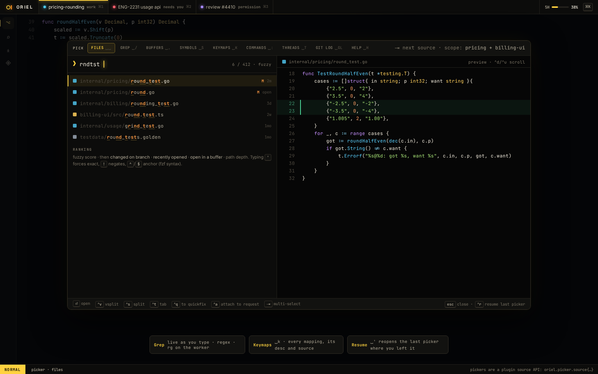

# SH-5 · Pickers (␣␣ files, ␣/ grep, ␣k keymaps…) with preview and actions

**Phase** 3 · shell · **After** [SH-4](SH-4-k-omnibox-sessions-commands-files-symbols-ticket.md) · **Unblocks** [FG-3](FG-3-project-search-and-replace-preview.md)

## Design

- `_design/ui.md`
- `_design/shell.md`
- `_design/rendering.md`
- `_design/help.md`
- `_design/theming.md`
- `_design/features.md` (this row)

## Mockups

## Done when

each source returns, ranks and previews; `␣'` resumes; quickfix and attach actions work

## From SH-4

- The omnibox (SH-4) ranks registry picker sources with `app/fuzzy`; a picker is the same engine over one
  source. Reuse `omnibox.results()` and its row and preview drawing rather than a second list.

## From ED-12

- `:ls` runs `buffers.switch` and `:copen` runs `quickfix.open`; ED-12 registers stand-in views (`buffers`,
  `quickfix`) for them. Replace both by registering the same command ids.

## Rules

- Start only when everything in **After** is `done`.
- No special cases: build on the general plugin APIs, and extend them generally if they're missing something (`_design/plugins.md`).
- Test-first, with verified spec references (`_design/testing.md`).
- No new dependency without approval (`_design/deps.md`).
- Update the design doc in the same PR if behaviour differs from it.
