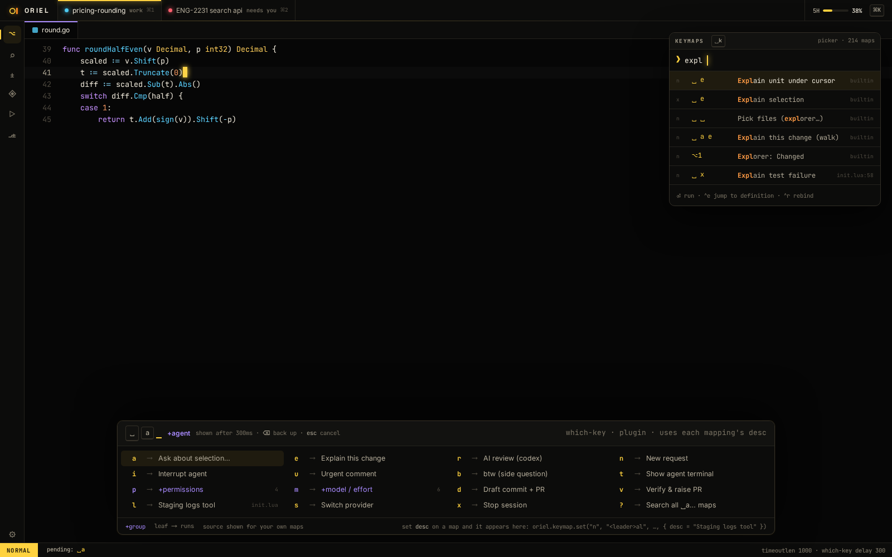

# SH-6 · Which-key popup

**Phase** 3 · shell · **After** [FW-3](FW-3-registries-commands-keymaps-modes-chords-panel-l.md), [FW-6](FW-6-widgets-buttons-chips-inputs-virtual-lists-trees.md) · **Unblocks** nothing yet

## Design

- `_design/ui.md`
- `_design/shell.md`
- `_design/rendering.md`
- `_design/help.md`
- `_design/theming.md`
- `_design/features.md` (this row)

## Mockups

## Done when

appears after 300 ms for any prefix, lists `desc`, `⌫` backs up

## Rules

- Start only when everything in **After** is `done`.
- No special cases: build on the general plugin APIs, and extend them generally if they're missing something (`_design/plugins.md`).
- Test-first, with verified spec references (`_design/testing.md`).
- No new dependency without approval (`_design/deps.md`).
- Update the design doc in the same PR if behaviour differs from it.
