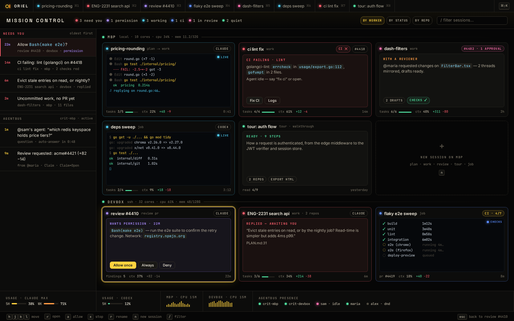

# SH-7 · Mission control (⌘⇧K) with live terminals and inline asks

**Phase** 7 · the rest · **After** [SH-2](SH-2-session-tabs-with-status-dots-and-1-9.md), [AI-1](AI-1-worker-wire-sessions-workspaces-with-multi-repo-.md) · **Unblocks** nothing yet

## Design

- `_design/ui.md`
- `_design/shell.md`
- `_design/rendering.md`
- `_design/help.md`
- `_design/theming.md`
- `_design/features.md` (this row)

## Mockups

## Done when

grouped by worker; working cards stream output; Allow/Deny works from the card

## Rules

- Start only when everything in **After** is `done`.
- No special cases: build on the general plugin APIs, and extend them generally if they're missing something (`_design/plugins.md`).
- Test-first, with verified spec references (`_design/testing.md`).
- No new dependency without approval (`_design/deps.md`).
- Update the design doc in the same PR if behaviour differs from it.
