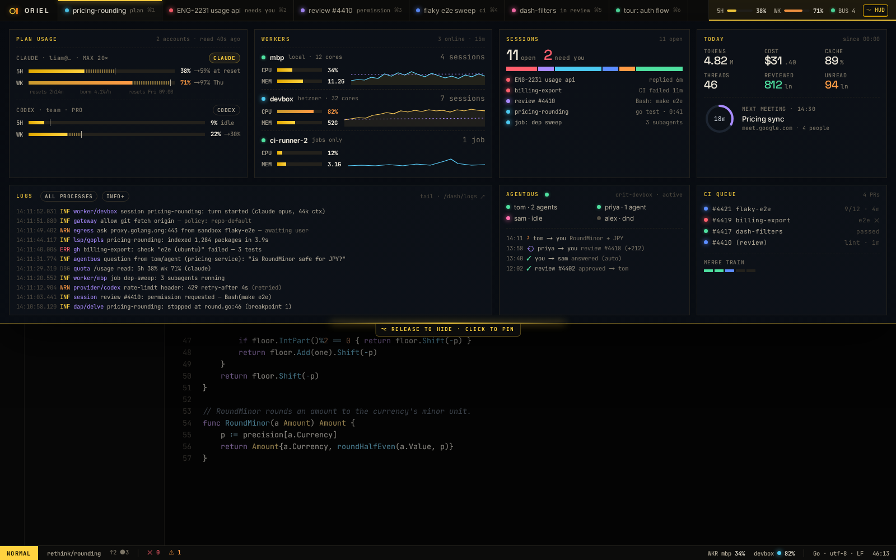

# SH-8 · HUD drawer (hold ⌥) and indicators in slots

**Phase** 7 · the rest · **After** [FW-6](FW-6-widgets-buttons-chips-inputs-virtual-lists-trees.md), [FW-2](FW-2-event-store-typed-events-materialised-core-state.md) · **Unblocks** nothing yet

## Design

- `_design/ui.md`
- `_design/shell.md`
- `_design/rendering.md`
- `_design/help.md`
- `_design/theming.md`
- `_design/features.md` (this row)

## Mockups

## Done when

every panel bound to live events; indicators updatable from Lua

## Rules

- Start only when everything in **After** is `done`.
- No special cases: build on the general plugin APIs, and extend them generally if they're missing something (`_design/plugins.md`).
- Test-first, with verified spec references (`_design/testing.md`).
- No new dependency without approval (`_design/deps.md`).
- Update the design doc in the same PR if behaviour differs from it.
