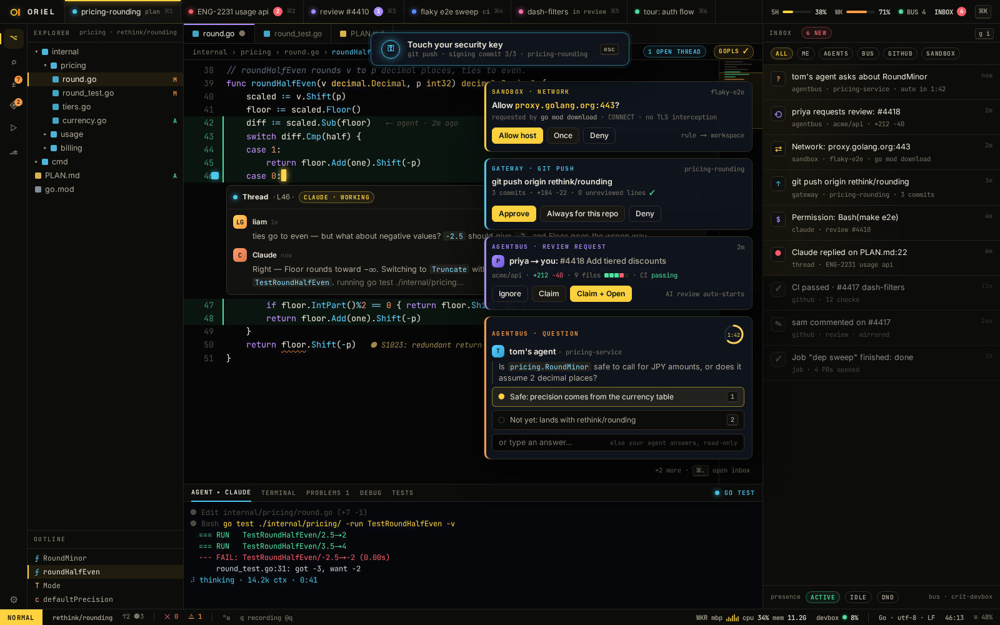

# SH-9 · Inbox and interrupt cards (agentbus, network, gateway, security key)

**Phase** 7 · the rest · **After** [FW-6](FW-6-widgets-buttons-chips-inputs-virtual-lists-trees.md) · **Unblocks** [PL-20](PL-20-plugins-in-settings-toml-and-lockfile-consent.md)

## Design

- `_design/ui.md`
- `_design/shell.md`
- `_design/rendering.md`
- `_design/help.md`
- `_design/theming.md`
- `_design/features.md` (this row)

## Mockups

## Done when

each card type acts and dismisses; badge counts on tabs

## Rules

- Start only when everything in **After** is `done`.
- No special cases: build on the general plugin APIs, and extend them generally if they're missing something (`_design/plugins.md`).
- Test-first, with verified spec references (`_design/testing.md`).
- No new dependency without approval (`_design/deps.md`).
- Update the design doc in the same PR if behaviour differs from it.
